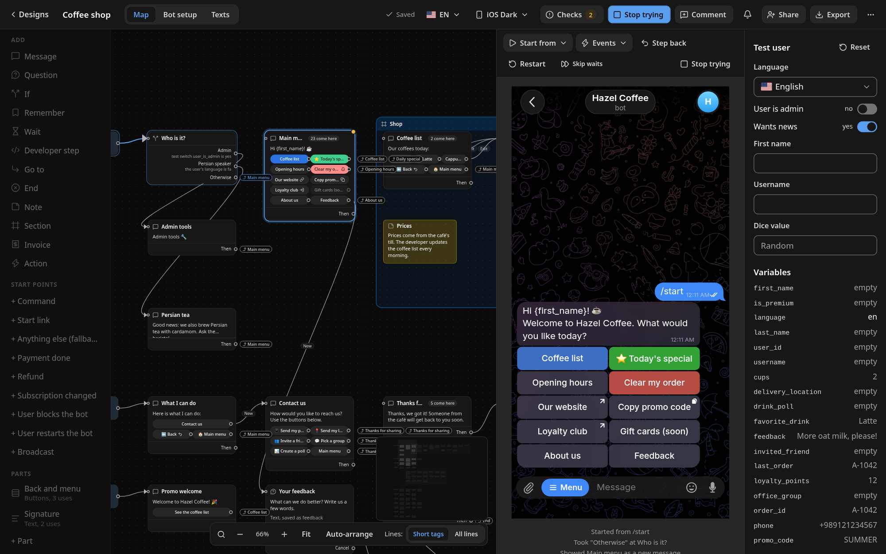
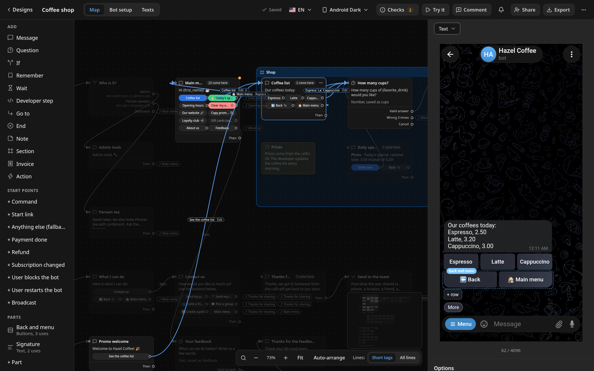
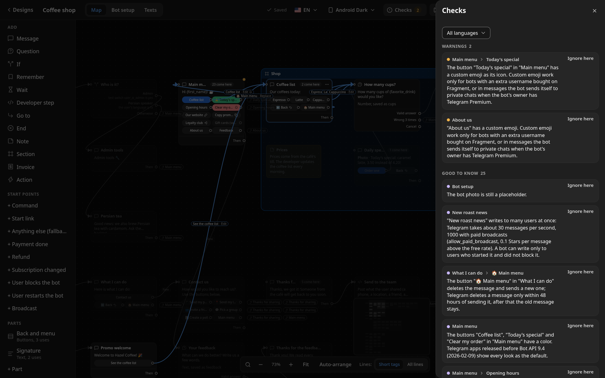
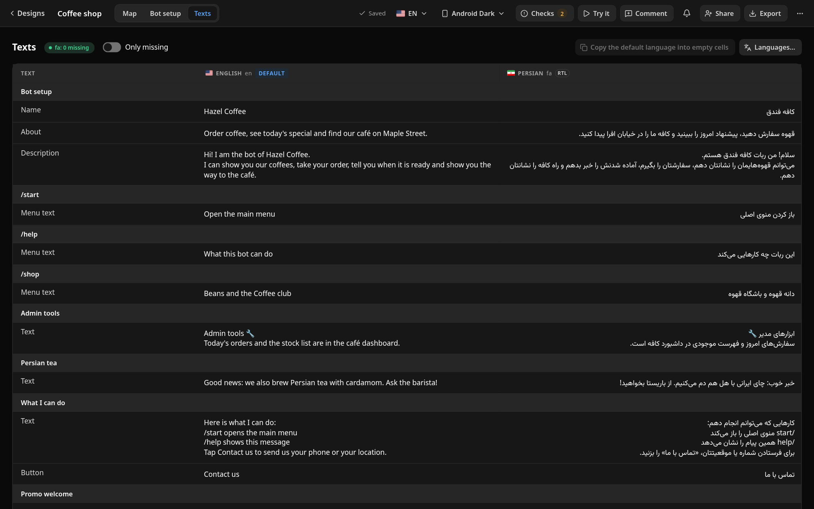
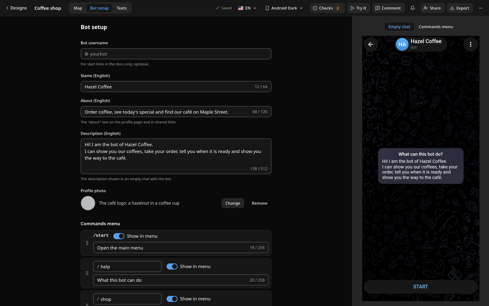

<p align="center">
  
</p>

xDesign is a self-hosted tool for designing Telegram bots without writing code. You lay the bot
out as a map of steps, edit each message on a phone preview that looks like the real Telegram
app, and click through it with Try it. When the design is done you export it, and a developer (or
Claude) builds the bot from that.

xDesign doesn't talk to Telegram and doesn't run bots. It only covers the design side.



## Features

- A map editor for the conversation: messages, questions, If branches, variables, waits, go-tos
  and endings, grouped into sections. Rows of buttons and bits of text can be saved as parts and
  reused across steps.
- The phone preview copies Telegram's Android, iOS, Desktop, Web A and Web K apps in light and
  dark, and you edit text and buttons right on it.
- Try it runs the bot inside the editor. You pick where to start, fake events like a payment or a
  broadcast, flip test switches and watch the variables change.
- Checks warns about Telegram's limits (text length, button rules, custom emoji, broadcast rates)
  and about steps that nothing leads to.
- Most of the Bot API is covered: photos, albums, files, polls, quizzes, dice, paid media,
  invoices in Stars or by card, subscriptions, refunds, reactions, pins and gifts.
- Any number of languages, right-to-left included, with a Texts table for translating side by
  side.
- Several people can edit the same design at once. There are comments, version history, roles
  per design and view-only links.
- Export gives you a zip with `spec.json` (and its JSON Schema), `design.md` and `HOW-TO-READ.md`,
  which explains the format to whoever builds the bot. Exports can be imported again.
- Claude can read and edit designs through the built-in MCP server (Claude Code, the Claude app
  and claude.ai).

<table>
  <tr>
    <td width="50%"></td>
    <td width="50%"></td>
  </tr>
  <tr>
    <td align="center">The editor</td>
    <td align="center">Checks</td>
  </tr>
  <tr>
    <td></td>
    <td></td>
  </tr>
  <tr>
    <td align="center">Texts</td>
    <td align="center">Bot setup</td>
  </tr>
</table>

## Download

Version 1.0.0. Pick a server if a team will use xDesign in the browser, or the desktop app if
it's just you on one computer.

| Platform | Type | x64 (Intel, AMD) | ARM64 |
|---|---|---|---|
|  Linux | Server | [Download](https://github.com/Sir-MmD/xdesign/releases/download/v1.0.0/xdesign-1.0.0-linux-amd64) (79 MB) | [Download](https://github.com/Sir-MmD/xdesign/releases/download/v1.0.0/xdesign-1.0.0-linux-arm64) (78 MB) |
|  Windows | Server | [Download](https://github.com/Sir-MmD/xdesign/releases/download/v1.0.0/xdesign-1.0.0-windows-amd64.exe) (73 MB) | [Download](https://github.com/Sir-MmD/xdesign/releases/download/v1.0.0/xdesign-1.0.0-windows-arm64.exe) (69 MB) |
|  Windows | Desktop app, installer | [Download](https://github.com/Sir-MmD/xdesign/releases/download/v1.0.0/xdesign-desktop-1.0.0-windows-amd64-setup.exe) (153 MB) | [Download](https://github.com/Sir-MmD/xdesign/releases/download/v1.0.0/xdesign-desktop-1.0.0-windows-arm64-setup.exe) (145 MB) |
|  Windows | Desktop app, portable | [Download](https://github.com/Sir-MmD/xdesign/releases/download/v1.0.0/xdesign-desktop-1.0.0-windows-amd64.exe) (153 MB) | [Download](https://github.com/Sir-MmD/xdesign/releases/download/v1.0.0/xdesign-desktop-1.0.0-windows-arm64.exe) (145 MB) |
|  Linux | Desktop app (AppImage) | [Download](https://github.com/Sir-MmD/xdesign/releases/download/v1.0.0/xdesign-desktop-1.0.0-linux-amd64.AppImage) (196 MB) | [Download](https://github.com/Sir-MmD/xdesign/releases/download/v1.0.0/xdesign-desktop-1.0.0-linux-arm64.AppImage) (197 MB) |
|  macOS | Desktop app | [Download](https://github.com/Sir-MmD/xdesign/releases/download/v1.0.0/xdesign-desktop-1.0.0-macos-amd64.zip) (194 MB)<br><sub>Intel Macs</sub> | [Download](https://github.com/Sir-MmD/xdesign/releases/download/v1.0.0/xdesign-desktop-1.0.0-macos-arm64.zip) (188 MB)<br><sub>Apple silicon (M1 and later)</sub> |

Not sure which column? Most PCs and servers are x64. ARM64 is for Macs with Apple silicon,
Windows on ARM laptops and ARM cloud servers.

The server files also come packed as `.tar.gz` (Linux) or `.zip` (Windows) with the same file
inside, and [`SHA256SUMS`](https://github.com/Sir-MmD/xdesign/releases/download/v1.0.0/SHA256SUMS) lists the checksums of every file. All versions are on
the [Releases](https://github.com/Sir-MmD/xdesign/releases) page.

## Running it

### On a server

On Linux (Ubuntu 24.04 or 26.04, Debian 12 or 13, Fedora 43 or newer; amd64 or arm64):

```bash
sha256sum --check --ignore-missing SHA256SUMS
chmod +x xdesign-1.0.0-linux-amd64
sudo ./xdesign-1.0.0-linux-amd64 --install
```

The installer asks for a domain, sets up HTTPS, picks a random port and path for the site and
creates the owner account. At the end it prints the address and the owner's password. Add
`--dry-run` if you want to see what it would do first.

On Windows Server 2019 or newer, or Windows 10 (1809+) and 11, run the `.exe` from a terminal
opened as Administrator:

```powershell
.\xdesign-1.0.0-windows-amd64.exe --install
```

After that, the `xdesign` command on the server handles status, backups, updates and rollback
(`xdesign help` lists everything). Updates can also be uploaded from Maintenance > Update in the
web UI.

### As a desktop app

If it's just you, there's a desktop build: a portable `.exe` or an installer for Windows, an
AppImage for Linux and a zipped `.app` for macOS. It works offline and has no accounts. The
builds aren't signed, so Windows and macOS will ask you to confirm the first time you open them.

## Building

You need Node.js 26, Go 1.27, GNU make and the usual command-line tools (curl, tar, xz, zstd,
zip, unzip, 7z, unsquashfs and so on; `build.sh` tells you if one is missing). `make setup-tools`
installs the pinned pnpm. The Windows desktop installer also needs Wine.

```bash
make setup-tools   # pinned pnpm and golangci-lint into .tools/bin
make install
make dev           # http://localhost:5173, data in .dev/data
make sanity        # the only check; run it before committing
```

For release files, run `./build.sh` and answer its questions, or pass everything up front:

```bash
./build.sh --version 1.0.0 --servers linux,windows --desktops windows,linux,macos \
  --windows-desktop both --arches amd64,arm64
```

Everything lands in `dist/` together with `SHA256SUMS` and the release notes. The build fetches
Node.js, Electron and rcodesign on its own and checks them against the hashes pinned in
`tools/release/`.

## Layout

```
apps/web           React SPA (Vite, TanStack Router and Query, Base UI, Tailwind)
apps/server        Fastify and Hocuspocus (Yjs), SQLite via Drizzle, the MCP server
apps/desktop       Electron wrapper around the server
packages/spec      design model, checks, Try it engine, export and import
packages/api       API contract (routes with their Zod schemas)
packages/preview   the Telegram phone preview
helper/            Go helper: installer, updates, backups, HTTPS
tools/             setup, sanity checks, release pins
```

## Docs

- [User guide](docs/user-guide.md)
- [How to read an export](packages/spec/docs/HOW-TO-READ.md), for whoever builds a bot from
  `spec.json`
- [Plan](docs/plan/README.md)

## License

All rights reserved.
